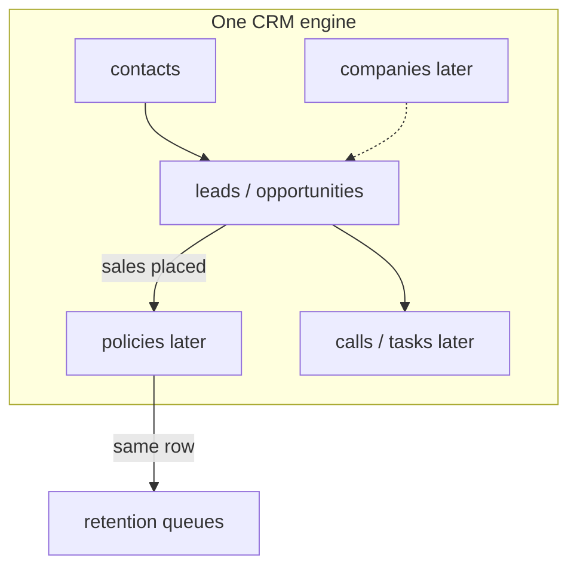

# CRM details from Jake’s ChatGPT — plan through Monday 28 Sep 2026

**Date:** 25 September 2026  
**Sources:** ChatGPT shares (Final Expense / Recruiting / PowerBridge / Retention).  
**Depends on:** `plan/crm-pipelines-kanban.md` (MVP already on Staging).  
**Rule:** one CRM engine + configurable pipelines. Do not build four separate CRMs. Staging only.

---

## 1. Already done (do not rebuild)

| Piece | Status |
| --- | --- |
| 4 purposes: Insurance Telesales, Recruiting, PowerBridge, Retention | Done |
| PowerBridge gated by `organizations.powerbridge_enabled` | Done (Jake orgs on) |
| Shortened per-purpose stages + Closed column | Done |
| `/leads` List \| Board with stage moves | Done |
| Campaigns filtered by purpose | Done |

This is the **skeleton**. ChatGPT’s full stages, fields, Policy object, Company model, dispositions, queues, and automations are **not** done.

---

## 2. Product decisions (locked for this plan)

1. **One engine:** Contacts / (Companies) / Opportunities(Leads) / Pipelines / Stages / Custom fields / Activities — configure four pipelines on top.
2. **Sales + Retention share Policy** — do not re-key policies into Retention.
3. **Disposition ≠ Stage** — terminal outcomes and call outcomes are a separate field/enum.
4. **PowerBridge stays Jake-only** until another org gets the flag.
5. **Insurance Telesales + Recruiting (+ Retention)** ship for all customers; PowerBridge remains gated.
6. **Admin-configurable custom fields** are the long-term design; Monday may ship **seeded packs** as JSON/columns first if faster, then migrate to a field registry.

---

## 3. Target for Monday 28 Sep (realistic “details” slice)

Goal for Jake’s Staging demo: **pipelines feel purpose-built**, not only renamed Sales/Recruiting boards.

### In scope (Mon)

| ID | Work | Done when |
| --- | --- | --- |
| D-01 | Expand **stage lists** closer to ChatGPT (sales / recruiting / retention / powerbridge), keep Closed + dispositions separate | Board columns match agreed shortened-but-fuller lists; migration + Zod update |
| D-02 | Add **`disposition`** on leads (enum per purpose; not a board column) | Create/detail/board card can set disposition; reports can filter later |
| D-03 | **Seeded field packs** on lead detail: core subset per purpose (see §5) — text/number/date/select stored as `leads.extra jsonb` or typed columns for the subset | Form sections show; RLS unchanged; isolation still PASS |
| D-04 | Expand contact fields needed by sales (DOB, secondary phone, timezone, best time, DNC, SMS/email consent) where missing | Contacts edit + display; no PII in git |
| D-05 | **Retention queue page** `/retention` (or `/leads?purpose=retention&view=board` polished): filters Pending / At risk / Payment problem using status + a few retention fields | Rep can open a work list without digging |
| D-06 | Staging walkthrough + short client note (what’s live vs next) | Jake can click through all 4 pipelines |

### Explicitly out for Monday (phase 2+)

- Full ChatGPT field lists (50+ underwriting/commission fields)
- First-class **Policy** table + Sales→Retention handoff
- PowerBridge **Company → Opportunity → Order** model
- Carrier/payment **automations** (NSF, grace, escalation)
- Retention KPI dashboard tiles (persistency, chargebacks)
- Admin UI to create custom fields
- TrustedForm / Jornaya / SureLC / carrier API sync
- Drag-and-drop Kanban library

---

## 4. Architecture (direction for developers)

- **Now:** `leads.purpose` + `leads.status` + `leads.disposition` + `leads.extra` (or pack columns).
- **Next:** `policies` with `contact_id`, `organization_id`, `writing_agent`, payment/retention columns; Retention UI reads policies, not a second lead copy.
- **Later:** `companies` for PowerBridge; opportunities link `company_id`.

Forms never accept `organization_id` as authority. RLS stays membership-based.

---

## 5. Monday field packs (seeded subset — not full ChatGPT)

### 5.1 Insurance Telesales (`sales`) — on lead + contact

**Contact (extend if missing):** DOB, gender, secondary phone, address parts already if present, timezone, best time to call, DNC, SMS consent, email consent, lead source.

**Lead pack:** coverage amount requested, monthly budget, tobacco Y/N, recommended carrier, quote amount, monthly premium, carrier, product, face amount, application number, policy number, application status, assigned agent (user id or text), next follow-up date, disposition.

### 5.2 Recruiting (`recruiting`)

**Lead pack:** recruit source, recruiter, licensed Y/N, resident state, NPN, life/health licensed, exam passed, contracting status, training completed, ready to sell, first sale date (optional), disposition.

### 5.3 PowerBridge (`powerbridge`) — still on lead for Monday

**Lead pack:** company name (text until Company table), job title, vertical, product/service, monthly volume, target CPL, quoted CPL, estimated monthly revenue, probability, expected close date, disposition.

*(Company entity = phase 2.)*

### 5.4 Retention (`retention`)

**Lead pack (until Policy table):** carrier, product, policy number, premium, policy status, draft day, last failed payment, days past due, grace end, retention owner, next follow-up, save outcome, disposition.

Queues use status + these fields (e.g. `at_risk` / `payment_monitoring` + days past due).

---

## 6. Stages to expand toward (Monday vs ChatGPT full)

| Pipeline | Monday approach |
| --- | --- |
| Sales | Add missing mid-stages where cheap: needs_analysis, pending_carrier, nurture; keep chargeback/cancelled in Closed or disposition |
| Recruiting | Add attempting_contact, interviewed, pre_licensing, exam_scheduled, contracting_pending, ready_to_sell, inactive |
| Retention | Align closer to: pending → issued → payment_monitoring → at_risk → conservation → saved / lapsed / cancelled |
| PowerBridge | Add discovery, sample_sent, pricing_sent, verbal_commit, nurture; keep client lifecycle fields for phase 2 |

Exact enum strings live in migration + `src/lib/crm/pipelines.ts`. Update CHECK constraints carefully; map old → new where needed.

---

## 7. Day plan (Fri 25 → Mon 28)

| Day | Focus |
| --- | --- |
| **Fri 25** | Commit/push Kanban MVP if not on hosted branch; confirm Staging demo of 4 pipelines |
| **Sat 26** | D-01 stages + D-02 disposition; migration on Staging |
| **Sun 27** | D-03/D-04 field packs + contact extensions; D-05 retention queue polish |
| **Mon 28** | D-06 walkthrough; client message; park Policy/Company/automations as dated follow-ups |

Capacity: treat as **one** primary workstream (~pairing). Do not start dialer/QuoteCoach in parallel this window.

---

## 8. After Monday (ordered)

1. **`policies` table** — create from sales “placed”; Retention reads same rows; writing agent + persistency fields  
2. **Dispositions + activities** reporting  
3. **Companies** for PowerBridge + link opportunities  
4. **Custom field registry** (admin CRUD, typed, per-pipeline visibility)  
5. **Automations** — payment failed → queue; grace &lt; 7d → priority; no contact 24h → escalate; payment promised → task  
6. Retention dashboard KPIs (pending buckets, past-due buckets, premium at risk)

---

## 9. Client message (send Mon or when Scheduling demo)

> Pipelines + Kanban for Insurance Telesales, Recruiting, Retention, and PowerBridge (your orgs only) are on Staging.  
> By Monday we’re adding fuller stages, dispositions, and the first field packs + a Retention work queue.  
> Shared Policy object, PowerBridge Companies, carrier payment automations, and the full ChatGPT field list are the next slice after that — one CRM engine, not four apps.

---

## 10. Definition of done (Monday)

- [ ] Stages expanded + disposition on leads  
- [ ] Seeded field packs visible per purpose on lead detail  
- [ ] Contacts have the sales-critical extra fields  
- [ ] Retention queue usable for pending / at-risk  
- [ ] PowerBridge still hidden for non-flagged orgs  
- [ ] Isolation campaigns + leads PASS  
- [ ] Staging demo script written (5–10 minutes)

**Commit policy:** provide commit text only unless Nicolas asks to commit.
