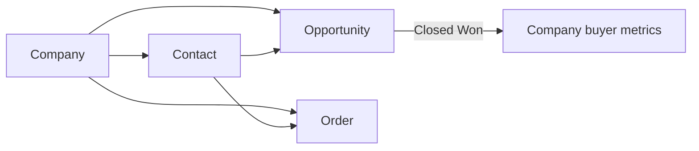

# PowerBridge Media CRM — client spec (updated)

**Date:** 25 September 2026  
**Source:** Jake — ChatGPT + Google Sheet (Customers / Hot Leads workbook).  
**Depends on:** `plan/crm-pipelines-kanban.md` (purpose gate), `plan/crm-monday-execution.md` (general CRM details).  
**Access:** `organizations.powerbridge_enabled` only (Jake orgs). Not for other customers.

---

## What Jake means (in one paragraph)

PowerBridge is a **B2B lead/data sales CRM**, not Final Expense people-leads. The spreadsheet mixes **prospects, customers, and orders** on the same rows. In TelesalesOS he wants those split: **Company → Contacts → Opportunities → Orders**, with a **simple 11-stage pipeline**, **dispositions ≠ stages**, **activities** for every touch, and **orders** that auto-calculate profit/margin and roll up lifetime customer metrics. Prospects and customers are the **same company record** — a prospect becomes a customer when the first opportunity is **Closed Won**.

---

## Do not recreate the spreadsheet tabs

| Spreadsheet today | CRM target |
| --- | --- |
| Hot Leads tab | Opportunities (open pipeline) |
| Customers tab | Same Companies after Closed Won + Orders |
| One row = person + order fields | Separate Opportunity vs Order |

**Rule:** When Lucas orders again, **do not** create another Lucas. Create a **new Order** under his Company/Contact.

---

## Stages (replace earlier SaaS-heavy list)

Keep the board simple so the team uses it:

1. `new_prospect` — New Prospect  
2. `attempting_contact` — Attempting Contact  
3. `contacted` — Contacted  
4. `qualified` — Qualified  
5. `pricing_sample_sent` — Pricing / Sample Sent  
6. `test_order_verbal` — Test Order / Verbal Commit  
7. `payment_pending` — Payment Pending  
8. `closed_won` — Closed Won / Customer  
9. `active_buyer` — Active Buyer  
10. `paused_nurture` — Paused / Nurture  
11. `closed_lost` — Closed Lost  

**Out for PowerBridge:** separate Discovery / Proposal / Negotiation stages (too SaaS-like for lead/data sales).

---

## Dispositions (separate from stage)

No Answer | Left Voicemail | Email Sent | Text Sent | LinkedIn Message | Spoke - Interested | Spoke - Follow Up | Pricing Requested | Pricing Sent | Sample Requested | Sample Sent | Ready to Order | Invoice Sent | Call Back Later | Already Has Provider | Price Too High | No Current Need | Not Interested | Bad Contact  

Every call/email/text/note/stage change → **activity** with timestamp (do not only overwrite “last disposition”).

---

## Data model (target)

### Company + Contact fields

Company Name, First/Last Name, Job Title, Phone, Email, Website, LinkedIn, **IMO / Agency / Parent**, State, Time Zone (auto), Account Owner, Lead Source, Date Added, Stage (on opportunity), Priority Hot/Warm/Cold.

### What they buy (opportunity / account prefs)

- **Vertical** multi-select: Final Expense, Life, Medicare, ACA, Health, Auto, Mortgage, Debt Settlement, Credit Repair, Tax Settlement, Bankruptcy, Legal, Solar, Roofing, Home Security, Home Warranty, Home Services, Other  
- **Product / Lead Type** multi-select: Aged Data, Real-Time Leads, Exclusive, Shared, Warm Transfers, Inbound Calls, Co-Reg, BPO, Voice AI, Telecom/Dialer Consulting, Other  
- Desired Lead Age (multi), States Needed, Typical Order Qty, Desired Monthly Volume, Purchase Frequency, Current Lead Provider, Current CPL, Target CPL, Lead Requirements, Filters/Criteria  

### Sales / opportunity fields

Stage, Opportunity Value, Est. Monthly Revenue, Quoted Price, Sample Sent + date, Pricing Sent + date, Expected Order Qty, Expected Close Date, Last Contact (auto), Next Follow-Up, Next Action, Last Disposition, Lost Reason, Sales Notes  

### Order (from Customers sheet — each purchase)

Order ID (auto), Order Date, Company, Contact, Vertical, Lead Type, Age Range, Lead Provider, Quantity, Cost Per Record, Extra Free Leads, States, Collected (revenue), Our Cost, **Gross Profit** (auto), **Gross Margin %** (auto), Payment Method, Payment Status, Payment Terms, Paid Provider, Delivery Status, Delivery Date, Notes  

`Gross Profit = Collected − Our Cost`  
`Margin % = Profit ÷ Collected` (guard divide-by-zero)

### Customer rollups on Company (after first Closed Won / first order)

Customer Since, Last Order Date, Days Since Last Order, Total Orders, Lifetime Revenue / Cost / Gross Profit, AOV, Average Margin, Total Leads Purchased, Last Product, Last Vertical, **Buyer Status**: New Customer | Active Buyer | VIP/High Volume | At Risk | Paused | Churned  

**Value later:** “no order in 30 days” call lists.

---

## Phasing vs current code

| Layer | Status |
| --- | --- |
| `purpose = powerbridge` + org gate | **Done** |
| Lead-as-opportunity + short stages + Kanban | **Done (temporary)** — stages should be **replaced** by the 11 above |
| Company / Order tables + profit rollups | **Not started** — PowerBridge phase 2 |
| Monday general CRM (sales/recruiting/retention packs) | See `plan/crm-monday-execution.md` — PowerBridge pack on `leads.extra` can use a **subset** of opportunity fields until Companies/Orders exist |

### Monday-safe subset (on lead until Companies ship)

Keep using `leads` with purpose `powerbridge` + updated 11 stages + disposition + `extra` keys: company_name, job_title, imo, vertical, product_lead_type, states_needed, target_cpl, quoted_cpl, opportunity_value, sample_sent, pricing_sent, next_follow_up, priority.  

**Do not** pretend Orders exist Monday — say “orders/profit rollups next slice.”

### Next PowerBridge slice (after Monday details)

1. `companies` + `company_contacts`  
2. Opportunities = leads with `company_id` (or rename)  
3. `orders` + auto profit/margin  
4. Company buyer rollups + At Risk queue (30 days)  
5. Activities timeline  

---

## Message for developer (Jake’s words, condensed)

> PowerBridge Media: one unified company/contact DB. Prospects become customers on Closed Won. Structure: Companies → Contacts → Opportunities → Orders. Every reorder = new Order. Keep sheet fields for orders; auto Profit and Margin %. Stage ≠ Disposition; log activities. Preserve IMO. Simple stages — no heavy SaaS pipeline.

---

## Definition of done (PowerBridge full)

- [ ] 11 stages live on board  
- [ ] Companies / Contacts / Opportunities / Orders on Staging  
- [ ] Reorder creates Order, not duplicate company  
- [ ] Profit / margin auto; lifetime metrics on company  
- [ ] Dispositions + activities  
- [ ] Still gated by `powerbridge_enabled`  
- [ ] Isolation PASS for new tables  
